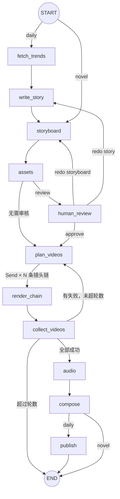

# short-video：热榜 → AI 短剧 → 抖音

把「抓热榜选题 → 豆包写原创小故事 → 分镜 → Seedream 定妆图 → Seedance 逐镜头视频 → 配音 → 合成成片」做成一张 LangGraph 图。支持人工审核暂停、进程中断后续跑、失败镜头自动重派发、单个镜头重做。成片可以用 [social-auto-upload](https://github.com/dreammis/social-auto-upload) 发布到抖音。

Agent 用法和流程规则见 [SKILL.md](SKILL.md)。

## 图结构



`uv run run.py graph` 从代码导出实际的图到 `docs/graph.mmd`。

| 文件 | 作用 |
|---|---|
| `gvcore/` | 业务逻辑：`config`（读环境变量）、`ark_client`（方舟 API）、`trends`（热榜）、`story`（选题写故事）、`step1_storyboard` ~ `step5_compose` |
| `gvgraph/state.py` | `GenState`（共享状态）和 reducer；`ChainTask`（Send 的私有输入） |
| `gvgraph/nodes.py` | 11 个节点 + 路由函数 |
| `gvgraph/graph.py` | 组装 StateGraph、RetryPolicy、SQLite checkpointer |
| `gvgraph/legacy.py` | 先设环境变量再 import gvcore（gvcore 在 import 时读配置） |
| `run.py` | 命令行：novel / daily / resume / review / status / history / graph |
| `trends_graph.py` | 小图：并行抓抖音、微博热搜前 N 条 |
| `story_from_source.py` | 指定热梗 + 原帖内容，让豆包写原创小故事 |
| `samples/crab/` | 示例故事和分镜 |
| `references/douyin-publish.md` | 抖音发布说明 |

## 安装

需要 Python 3.12+、[uv](https://docs.astral.sh/uv/)、FFmpeg。

```powershell
cd skills/short-video
uv sync
winget install Gyan.FFmpeg            # macOS: brew install ffmpeg
copy .env.example .env                # 填 ARK_API_KEY；也可以只设环境变量
```

API Key 只从环境变量 `ARK_API_KEY` 或本目录的 `.env` 读取（`.env` 已被忽略，不会入库）。火山方舟控制台需要先开通豆包大模型、Seedream、Seedance。

## 用法

```powershell
# 离线跑通（不调用方舟、不花钱：占位画面 + 真实配音、字幕、拼接）
uv run run.py novel --input samples/crab/story.txt --storyboard samples/crab/storyboard.json --mock --portrait --workdir crab --thread demo-crab

# 加 --review：分镜 + 定妆图之后暂停，人工审核
uv run run.py review --thread demo-crab --approve
uv run run.py review --thread demo-crab --redo storyboard --feedback "镜头再少一点"

# 真实生成：在出视频前停下检查，确认后续跑
uv run run.py novel --input samples/crab/story.txt --portrait --workdir crab --stop-before plan_videos
uv run run.py resume --thread novel-story

# 每日热点：热榜 → 选题 → 故事 → 分镜 → ... → work/daily/outbox/
uv run run.py daily --review on

# 查看
uv run run.py status  --thread daily-2026-10-19
uv run run.py history --thread daily-2026-10-19
```

- 同一个 thread 跑完想重来，加 `--fresh`（只清快照，已生成的图片和视频仍复用）。
- 单个镜头不满意：删掉 `work/novel/<名字>/3_videos/s005.mp4` 后 `--fresh` 重跑，只重新生成这一个镜头。
- 故障注入：`$env:GV_FAIL_SHOTS="s005"` 让 s005 第一次失败，观察 collect_videos → plan_videos 的重试环。
- 所有产物在 `work/`（已忽略）：`novel/`、`daily/<日期>/`、`daily/outbox/`、`checkpoints.sqlite`。

## 主要配置（环境变量或 .env）

| 变量 | 默认 | 说明 |
|---|---|---|
| `ARK_API_KEY` | 无 | 必填（mock 模式不需要） |
| `LLM_MODEL` / `IMAGE_MODEL` / `VIDEO_MODEL` | 豆包 seed / Seedream 5.0 / Seedance 2.0 | 也可以填推理接入点 `ep-xxx` |
| `VIDEO_RESOLUTION` | `720p` | 样片阶段可用 `480p` |
| `DIALOGUE_MODE` | `tts` | `tts` 对白由 edge-tts 配（音色统一）；`native` 由 Seedance 直接出人声 |
| `AIGC_LABEL` | 竖屏/每日模式为 `AI生成` | 成片右上角的 AI 生成标识 |
| `DAILY_REVIEW` | `0` | `1` 表示每日模式在定妆图后暂停审核 |
| `DAILY_BLOCKWORDS` | 内置列表 | 热榜敏感词过滤 |

完整列表见 [.env.example](.env.example) 和 `gvcore/config.py`。

## 限制

- 热榜接口是各平台网页公开使用的非官方接口，随时可能改版或要求登录；某个源失败会跳过。
- Seedance 单镜头 4~15 秒；镜头之间靠定妆图参考和末帧接续保持一致，长片仍可能出现人物漂移。
- 字体默认用 Windows 的微软雅黑（`C:/Windows/Fonts/msyh.ttc`），其他系统请设置 `SUB_FONT`、`MOCK_FONTFILE`、`LABEL_FONTFILE`。
- 视频生成按秒计费，务必先用 `--mock` 和 `--stop-before plan_videos` 检查。

## 测试

```powershell
uv run --project skills/short-video python evals/short-video/run_evals.py
```

离线 mock 跑一遍完整流水线并检查成片，不调用任何付费接口。
